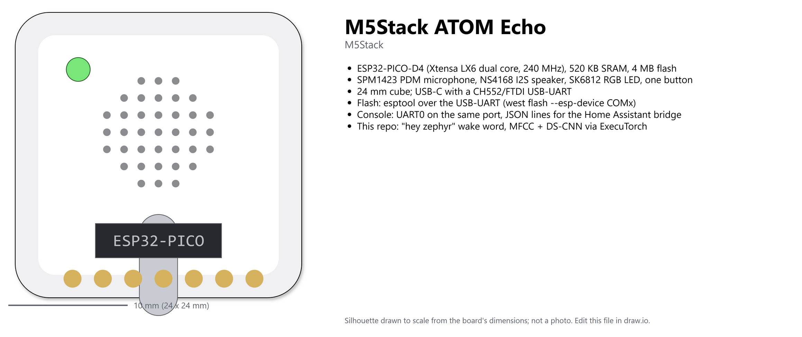
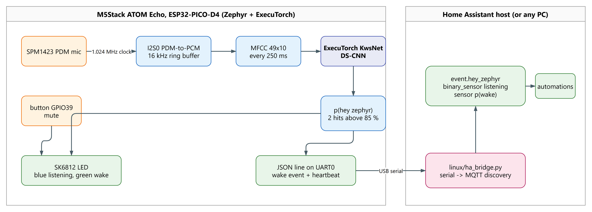

# "Hey Zephyr" on the M5Stack ATOM Echo: a Zephyr + ExecuTorch wake-word device for Home Assistant

The ATOM Echo is a 24 mm cube with an ESP32-PICO-D4, a PDM microphone, a small speaker, an
RGB LED and a button: the hardware everyone already uses as a voice satellite for Home
Assistant. This repo gives it a different brain: Zephyr RTOS, a PyTorch keyword-spotting
model exported with [ExecuTorch](https://github.com/pytorch/executorch) and run by the
[ExecuTorch Zephyr module](https://docs.zephyrproject.org/latest/develop/manifest/external/executorch.html),
and a custom wake word, **"hey zephyr"**, trained on synthetic speech so nobody has to record
anything. A wake event becomes a Home Assistant `event` entity you can trigger automations from.



*Board overview source: [docs/diagrams/board.drawio](docs/diagrams/board.drawio), editable in draw.io.*



*Diagram source: [docs/diagrams/overview.drawio](docs/diagrams/overview.drawio), editable in
[draw.io](https://www.drawio.com/); re-export to `docs/images/overview.png`.*

**Status: running on the board, microphone under test.** Measured on the ATOM Echo on
2026-10-12: the C front end matches the Python one to 2e-5, the exported model matches
PyTorch to 4e-6, one inference takes 172 ms (24-channel model) and the 49-frame MFCC 30 ms,
with the kernels built at -O2. The PDM capture runs at a steady 16,000 samples/s with no
overruns, the 1.024 MHz clock is on GPIO33 and the mic's data line is live; what is still
being checked is the decoded audio level, which has not yet been seen reacting to sound
(see Verify, step 4). The trained model scores 96.6 % on held-out clips.

## What is in the repo

| Path | What |
|---|---|
| `firmware/` | Zephyr app for `m5stack_atom_lite/esp32/procpu` (the Echo is an ATOM Lite plus audio): `src/mic.c` PDM capture, `src/mfcc.c` front end, `src/main.cpp` self-tests + wake loop, `src/led.c` |
| `firmware/model/kws.pte` | the exported model the firmware embeds (KwsNet ch=24, trained on the synthetic set; also at [eoinedge/KwsNet](https://huggingface.co/eoinedge/KwsNet)) |
| `train/features.py` | the MFCC recipe in numpy, mirrored line for line by `mfcc.c` |
| `train/make_dataset.py` | synthesises the training set with piper TTS + Google Speech Commands + noise |
| `train/train_kws.py`, `train/export_kws.py` | train KwsNet, export the .pte and the self-test headers |
| `linux/ha_bridge.py` | serial-to-MQTT bridge with Home Assistant discovery |
| `docs/diagrams/` | draw.io sources for the pictures above |

## Hardware

| Part | ESP32 pin | Zephyr |
|---|---|---|
| SPM1423 PDM microphone | CLK GPIO33, DATA GPIO23 | `i2s0` in PDM-to-PCM receive mode (`firmware/app.overlay`) |
| NS4168 I2S speaker | BCLK GPIO19, LRCK GPIO33, DATA GPIO22 | not used yet; shares GPIO33 with the mic clock |
| SK6812 RGB LED | GPIO27 | `led-strip` alias from the board file (ws2812 over SPI3) |
| Button | GPIO39 | `sw0` alias; toggles mute |
| USB-UART | UART0 | console + JSON lines, 115200 8N1 |

Zephyr has no PDM mode for the ESP32 I2S driver, so `mic.c` configures it as a 16-bit stereo
master at 32 kHz (bit clock 1.024 MHz, the 64x clock a PDM mic wants for 16 kHz output) and
then switches I2S0 into PDM-to-PCM mode with the ESP-IDF HAL. The first half second measures
the DMA word rate and picks the halfword that carries the samples; `CONFIG_APP_MIC_DEBUG=y`
prints the rates, RMS and peak frequency once a second so you can check it with a tone.

## How it works

1. **Capture.** A 16384-sample ring buffer holds the newest 1.02 s of 16 kHz audio.
2. **Front end.** Every 250 ms the newest second is turned into 49 frames x 10 MFCCs
   (30 ms Hann window, 20 ms hop, 512-point FFT, 40 mel bands from 20 Hz to 4 kHz, log,
   DCT-II). `train/features.py` and `firmware/src/mfcc.c` implement the same recipe and the
   device checks them against each other at boot on an embedded test clip.
3. **Model.** KwsNet, a depthwise-separable CNN (`train/kws_model.py`): a 10x4 strided stem,
   two DS-conv blocks, global average pool, three logits: silence, unknown, hey_zephyr.
   Only conv2d, relu, mean and addmm, so ExecuTorch's portable kernels cover it with no
   delegate.
4. **Decision.** `p(hey_zephyr)` above `CONFIG_APP_WAKE_THRESHOLD_PERCENT` (85) on
   `CONFIG_APP_WAKE_CONSECUTIVE` (2) windows in a row fires a wake event, then a 1.5 s hold-off.
   The LED goes green for a second and one JSON line goes out.

## Quick start

```bash
python3 -m venv .venv && source .venv/bin/activate
pip install -r requirements.txt --extra-index-url https://download.pytorch.org/whl/cpu
python train/export_kws.py                 # seeded weights: pipeline check, builds and self-tests

west init -m https://github.com/eoinjordan/executorch-zephyr-m5stack-atom-echo ws
cd ws && west update --narrow -o=--depth=1 && west packages pip --install
west sdk install --toolchains xtensa-espressif_esp32_zephyr-elf
west build -p always -b m5stack_atom_lite/esp32/procpu executorch-zephyr-m5stack-atom-echo/firmware
west flash --esp-device /dev/ttyUSB0 --esp-baud-rate 115200
```

On Windows add `pip install torch --index-url https://download.pytorch.org/whl/cpu`, put 7-Zip
on `PATH` for `west sdk install`, pass
`-- -DFLATC_EXECUTABLE=<venv>/Lib/site-packages/executorch/data/bin/flatc.exe` to `west build`,
and use `--esp-device COMx`. The ATOM's USB-UART does not like 921600 baud; 115200 or 460800
works.

### Training the real wake word

```bash
python -m venv .venv-tts && .venv-tts/bin/pip install piper-tts numpy soundfile
# voices: huggingface.co/rhasspy/piper-voices, e.g. en_US-libritts_r-medium (904 speakers) plus a few single-speaker ones
# negatives: http://download.tensorflow.org/data/speech_commands_v0.02.tar.gz
.venv-tts/bin/python train/make_dataset.py --voices <piper-voices> --speech-commands <speech_commands>
python train/train_kws.py                        # ~10k clips, a few minutes on CPU
python train/export_kws.py --checkpoint train/out/kws.pt
west build ...                                   # rebuild with the trained model
```

The checkpoint carries the per-coefficient normalisation the firmware applies, and
`export_kws.py` writes it into `firmware/src/features_test.h` next to the test clip.

## Console

What the device prints at boot and while listening (JSON lines are the contract with the
bridge):

```
Hey Zephyr on m5stack_atom_lite/esp32/procpu (Zephyr 4.4.0): ExecuTorch wake word
model: 16972 bytes in flash, method pool 32768 B, temp pool 8192 B
planned buffer 0: 24000 bytes
method 'forward' loaded; input numel 490; pool used 30216 / 32768 bytes

self-test:
  mfcc : 49 frames in 29970 us, max|c-python|=1.96e-05 ok
  kws  : logits [-32.9729 11.3140 -9.8242] pred=1 (_unknown_) expected=1 max|esp32-pytorch|=3.8e-06 (171907 us)
  chain: C mfcc -> model, max|logit diff|=1.1e-05
SELF-TEST PASS
mic: SPM1423 PDM on I2S0 (clk GPIO33, data GPIO23), bck 1024000 Hz, slot right, pick auto
mic: 8000 DMA words/s in the first 512 ms -> pick mode 2
mic: 8000 words/s 16000 samples/s pick 2 rms lo 65 hi 67 peak 7406 Hz overruns 0
{"seq":0,"t_ms":5238,"wake":0,"top":"_unknown_","p_wake":0.273,"infer_us":95213,"samples":71680}
```

(The `mic:` rate lines come from `CONFIG_APP_MIC_DEBUG=y`. 8000 DMA words/s is right: in
mono PDM mode the ESP32 packs two 16-bit samples into each 32-bit word.)

## Home Assistant

The device talks JSON over USB; `linux/ha_bridge.py` runs wherever it is plugged in (the HA
host, a Pi, your desk) and announces it over MQTT discovery:

```bash
pip install paho-mqtt pyserial
python linux/ha_bridge.py --port /dev/ttyUSB0 --broker homeassistant.local --user mqtt --password ...
```

You get `event.hey_zephyr` (fires `hey_zephyr`), `binary_sensor.hey_zephyr_listening` and
`sensor.hey_zephyr_p_wake`. An automation:

```yaml
triggers:
  - trigger: state
    entity_id: event.hey_zephyr
actions:
  - action: light.toggle
    target:
      entity_id: light.desk
```

For a true Assist satellite (stream the words after the wake word to HA's speech-to-text and
play the reply) the next step is a Wyoming client; see Roadmap.

## Testing without talking to it

Play the wake word at it. Synthesised clips from a voice the model never heard are in
`train/data/hey_zephyr/positive` after `make_dataset.py` (hold a few voices out with
`--seed`), or use any free audio source: a text-to-speech site, a YouTube or SoundCloud clip
with someone saying "hey zephyr", a podcast for false-accept testing. On Windows,
`(New-Object Media.SoundPlayer "clip.wav").PlaySync()` plays a file through the speakers; on
Linux `aplay clip.wav`. Watch the console for `"wake":1` and the LED for green.

## Verify

1. **Build is clean.** `west build` ends with the memory report and no `error:` lines.
2. **Front end agrees.** `mfcc : ... max|c-python|` is below `2e-2` and says `ok`.
3. **Model agrees.** `kws  : ... max|esp32-pytorch|` is below `1e-3`, argmax matches, and the
   line ends with `SELF-TEST PASS`.
4. **Microphone is alive.** With `CONFIG_APP_MIC_DEBUG=y`, `mic:` lines report about 16000
   samples/s, RMS that rises when you talk, and a peak near 1000 Hz when you play a 1 kHz tone.
5. **It wakes.** Say or play "hey zephyr": a `"wake":1` line and a green LED. Say other things:
   no event.

## Roadmap

- On-device Wi-Fi + MQTT (needs the Espressif Wi-Fi blobs, `west blobs fetch hal_espressif`,
  and `mbedtls` in the manifest), then a Wyoming satellite so the device streams audio to
  HA Assist after the wake word.
- A beep through the NS4168 on wake (the speaker shares GPIO33 with the mic clock, so the I2S
  mode has to flip for the duration of the beep).
- int8 model: no CMSIS-NN on Xtensa, so this is the portable quantized kernels, worth measuring.

## Further reading

- [ExecuTorch](https://pytorch.org/executorch/) and the
  [Zephyr module](https://docs.zephyrproject.org/latest/develop/manifest/external/executorch.html)
- [Home Assistant Assist and Wyoming](https://www.home-assistant.io/voice_control/)
- The other boards in this series:
  [UNO Q anomaly detection](https://github.com/eoinjordan/executorch-zephyr-arduino-uno-q),
  [Pico4ML-BLE digit reader](https://github.com/eoinjordan/executorch-zephyr-arducam-pico4ML-BLE),
  [ExecuTorch vs TFLM benchmarks](https://github.com/eoinjordan/executorch-vs-tflm-benchmarks)
- Models and data: [eoinedge on Hugging Face](https://huggingface.co/eoinedge)

## License

Apache-2.0. Piper voices are MIT/CC; Google Speech Commands is CC BY 4.0 (used for
negatives, not redistributed here).
